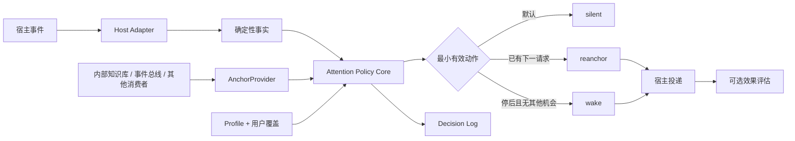

# Agent Attention Policy 设计

> 来源快照：复制自内部事件总线仓同路径（该仓未公开）；未改动源仓。下文状态反映原设计时点；本仓执行授权和接口补充见 [阶段零](2026-10-25-phase-zero.md)与 [runtime 契约](2026-10-25-runtime-contract.md)。仅修正迁移后的文档导航，不将旧方案重新授权。

## 结论

抽取一个 **Agent Attention Policy** 库：根据宿主事件、当前状态和模型策略，决定应该保持沉默、在下一次请求前重锚定，还是主动补一次推理。

它不是通用 scheduler、业务事件平台或记忆系统。库的核心只持有 `AnchorRef`，由 内部知识库、内部事件总线 等消费者拥有具体知识与角色内容；宿主 adapter 拥有事件与投递。首个实现为 TypeScript core + Pi adapter，内部知识库 与 事件总线 是两个真实消费者。

动作收敛为 `silent / reanchor / wake`。首版明确排除 LLM judge、daemon、离线队列、在线自动调参和强制 continuation。

研究依据见[模型记忆曲线、注意力衰减与角色／规则遗忘](../research/agent-im/2026-10-24-model-attention-interventions.md)。此前《Pi 可配置事件召回包设计》（原仓对应暂停方案文档，文件名含私有项目代号已脱敏；暂停方案不随本次迁移）因问题被重新框定为注意力干预而暂停，不按其实施。

## 1. 目标与边界

### 1.1 要解决的问题

规则、角色和未决意图仍可能存在，但模型在需要决策时无法稳定地让它们影响行动。需要区分：

- 信息已丢失；
- 信息存在但未进入当前上下文；
- 信息在上下文中但被长度、位置或新目标稀释；
- 延迟意图未在执行时机被想起；
- 会话 settled 后没有下一请求可承载提醒；
- 提醒已投递但未被采用，或造成过度行动。

本库只处理“何时以何种最小动作重新提供注意力机会”，不证明模型已经遗忘，不拥有信息真相，也不承诺任务恢复。

### 1.2 成功标准

1. 内部知识库 与 事件总线 能使用同一纯 core，而不互相依赖。
2. 默认 `silent`；能够 `reanchor` 时不额外 `wake`。
3. 每个 session 至多一个 emit owner，避免多消费者重复提醒。
4. profile 可按宿主、模型、任务和策略版本选择，并允许用户覆盖与撤回。
5. 决策、抑制、投递、采用与成本分别可观测。
6. 新模型或宿主基线不再需要库时，对应策略可关闭或删除。
7. 首版开源产物包含可重放评测，不只有注入功能。

### 1.3 非目标

- 通用 cron、业务调度、CEP 或开放 watcher 平台；
- memory bank、Todo、角色存储、知识库或共享任务状态；
- broker、session registry、全局扩展发现或第二套通信机制；
- daemon、离线队列、durable outbox 和跨进程恢复；
- 运行中 LLM judge、无界自我调参或按排行榜硬编码模型强弱；
- 用一次投递成功冒充模型已理解、已续跑或任务已完成。

## 2. 方案取舍

| 方案 | 优点 | 主要代价 | 裁决 |
|---|---|---|---|
| **纯策略 core + 宿主 adapter** | 两个消费者共享策略；宿主和业务各自独立；可用统一契约测试 | 需要先定义最小接口并迁移现有行为 | **采用** |
| Pi 专用完整扩展 | 初版直接，少一层公共接口 | 再次形成 Pi 专属大扩展，内部知识库 无法复用 | 不作为开源库边界 |
| 通用注意力平台 | 一次覆盖多宿主、memory、judge、daemon | 运维与验证先于收益，重复现有基础设施 | 首版排除 |

核心设计判断：开源价值是**跨宿主一致的策略、日志与评测**，不是提醒功能本身。

## 3. 总体结构



### 3.1 模块职责

| 模块 | 接口责任 | 不得拥有 |
|---|---|---|
| `core` | 候选有效性、状态、profile、动作选择、去重、预算、冷却与日志 schema | 宿主 API、角色/KB 内容、文件与网络 I/O |
| `AnchorProvider` | 按引用提供当前有效、精简的锚点快照 | 提醒频率、宿主注入、模型选择 |
| `HostAdapter` | 事件转事实、timer、生命周期、投递与提交结果 | 业务语义、profile 真相、跨宿主阈值 |
| `testing` | fake clock、fake sink、replay 与 adapter 契约测试 | 线上状态与真实模型效果断言 |
| 消费者 | 产生业务相关候选、提供锚点、评估业务采用 | 复制 core 的状态机与频控 |

事件 Adapter 不直接注入；AnchorProvider 不自行决定提醒；各控制入口不绕过 core。

## 4. 公共契约

以下为设计契约，不是已发布 API。

### 4.1 锚点

```ts
interface AnchorProvider {
	get(ref: AnchorRef): AnchorSnapshot | undefined;
}

interface AnchorSnapshot {
	ref: AnchorRef;
	version: string;
	content: string;
	expiresAt?: number;
}
```

- 内部知识库 提供规则、知识和路由锚点；事件总线 提供当前角色记录。
- 候选和待决状态只携带 `AnchorRef`，不复制正文。
- 投递前重新读取快照，避免角色或规则更新后注入旧版本。
- `content` 必须精简、有大小上限；失效或缺失时不得伪造回退内容。

### 4.2 候选

```ts
interface AttentionCandidate {
	scope: string;
	generation: number;
	epoch: string;
	anchor: AnchorRef;
	facts: Record<string, unknown>;
	observedAt: number;
	decisionDeadline?: number;
	provenance: "external" | "attention";
	revision: number;
}
```

`facts` 只包含宿主可观察事实和可复算派生，不得写入“已遗忘”“需要协作”“正在收尾”等未经 classifier 支持的语义结论。语义未知时省略并记 `unknown`，不得由 adapter 补猜。

`provenance: "attention"` 的候选默认不能在同一因果链再次武装。`revision`、`generation`、`epoch` 共同阻止旧配置和旧活动回调污染新状态。

### 4.3 动作

```ts
type AttentionAction =
	| { kind: "silent"; reason: string }
	| { kind: "reanchor"; anchor: AnchorRef; reason: string }
	| { kind: "wake"; anchor: AnchorRef; reason: string; expiresAt: number };
```

- `silent`：不注入；可记录候选与抑制原因。
- `reanchor`：在已发生的下一模型请求中提供短暂锚点，不主动新增 turn。
- `wake`：仅在会话 settled、候选仍有效且预算允许时，主动补一次推理机会。

首版没有 `hardGate`。不允许仅凭 turns/bytes/idle 升级成强制续跑。

### 4.4 PolicyCore

```ts
interface PolicyCore {
	evaluate(candidate: AttentionCandidate): AttentionDecision;
	applyConfig(config: AttentionConfig): void;
	getState(): AttentionState;
}
```

core 是纯决策模块，不直接读取 AnchorProvider 或调用宿主。AnchorProvider 的读取发生在投递前，由组合层完成并再次校验版本、过期和 revision。

## 5. 决策与状态不变量

### 5.1 决策顺序

```text
候选到达
  → revision / generation / epoch 有效？
  → provenance 是否自激？
  → anchor 是否存在、未过期、值得重新提供？
  → 相同 anchor@version 是否已在有效窗口内提供？
  → 是否被 cooldown / budget 抑制？
  → 当前是否存在下一请求？
       ├─ 是：reanchor
       └─ 否：已 settled 且候选仍值得新增推理？
              ├─ 是且预算允许：wake
              └─ 否：silent 或保留有界候选
```

候选是否保留必须有明确 deadline；过期后不得补发。`drop` 与 `defer` 的语义需在日志中区分。

### 5.2 不变量

1. 旧 revision、generation、epoch 的事件、timer 和异步回执不得产生动作。
2. 相同 `anchor@version` 在配置的去重窗口内至多投递一次；新版本是否重新提供由策略决定。
3. `reanchor` 默认只存在于当前请求，不写入 durable message history。
4. `wake` 必须有次数、频率和过期上限，并防自激。
5. 无具体锚点或确定性线索时，不生成“继续努力/你确定吗”等无信息提醒。
6. `sendMessage` 或宿主等价调用成功只记 `submitted`，不得记 `adopted`。
7. 模型切换只影响后续 profile；不自动产生提醒，也不把旧模型阈值视为新模型已验证配置。
8. 新配置先完整校验，再原子替换；失败保留旧 revision 和旧 runtime。
9. shutdown、reload、session switch 时取消订阅与 timer，旧回调即使迟到也无效。

## 6. Profile 与配置

### 6.1 Profile 键

```text
host + hostVersion
model + provider/revision
taskFamily + roleTopology
policyVersion + reminderTextVersion
```

`taskFamily` 至少区分机械单线程、延迟委派、多角色接力、压缩恢复和合法等待；`roleTopology` 防止把无需协作误当角色遗忘。

### 6.2 策略内容

每个 profile 可控制：

- `off / shadow / emit`；
- 允许 `reanchor`、`wake` 中的哪些动作；
- 候选阈值、去重窗口与 cooldown；
- 每阶段最大注入次数；
- wake 最大次数、频率与过期时间；
- reminderTextVersion。

库不提供跨模型“最佳阈值”。随包配置只能标为 conservative 或已有标定条件的版本化 profile。

### 6.3 合并与回退

```text
conservative 默认
  → 已标定的 host/model/task profile
  → 用户显式覆盖
```

未知模型不根据名称猜测强弱，也不继承“相似模型”阈值；使用保守默认或 shadow。模型切换不自动继承未验证 profile。

新 profile 只能来自离线 replay/A/B 后发布的配置版本。线上不持续自我调参；用户可关闭、覆盖和回退。

## 7. 包与消费关系

首版保持一个包，避免过早拆 monorepo：

```text
@scope/agent-attention
  /core       纯决策、profile、状态与日志类型
  /pi         Pi 事件与投递 adapter
  /testing    replay、fake clock、fake sink、契约测试
```

依赖方向：

```text
内部知识库 ───────┐
            ├─→ core
内部事件总线 ─────┘

Pi extension → /pi → core
```

- 内部知识库 与 事件总线 不互相依赖。
- core 不 import Pi、内部知识库 或 事件总线。
- package version 与 policyVersion、reminderTextVersion 分开。
- 其他宿主只有出现真实消费者后才增加 adapter。

### 单 owner 规则

- shadow 阶段允许多个消费者同时记录候选。
- emit 阶段每个 session 只能有一个注意力投递 owner。
- 其他消费者只注册 AnchorProvider 或保持 shadow，不并行发送 Wake。
- 初期通过显式组合指定 owner，不做自动发现或全局 registry。
- 两个项目可以分别验证同一 core，不要求立即在同一 session 同时启用。

## 8. 观测、隐私与错误

### 8.1 决策日志

至少记录：

```text
host/model/task/profile/policyVersion/reminderTextVersion
candidate facts + anchorRef + anchorVersion
action + reason + suppressedBy
delivery result
token / extraRun / latency（可取得时）
可选 adoption / falseAction
```

默认不保存完整 prompt、角色正文或 transcript。日志有界，原始事实缺失用 `unknown/unobserved`，不得合并成 `false`。

### 8.2 结果语义

- `submitted`：已交给宿主；
- `duplicate`：被去重；
- `suppressed`：被预算、冷却或 profile 抑制；
- `expired`：候选在投递前失效；
- `failed`：宿主明确失败；
- `unknown`：结果无法确认；
- `adopted`：只能由独立行为证据填写，不能由 submitted 推断。

### 8.3 错误与安全

- 非法配置、未知事件、无效时长和阈值必须显式报错，不静默开启。
- 新能力的加载失败默认 `off` 或 shadow，不因配置断链突然 emit。
- 配置不能执行 JavaScript；锚点与事件证据限制大小并视为不可信数据。
- 项目配置遵守宿主 project trust；加载配置不得自动启动进程、网络或 watcher。
- core 状态可序列化，但持久化由 adapter 决定；首版不承诺进程退出后补发。

## 9. 验证设计

### 9.1 V0：纯核心契约

覆盖：

- revision、generation、epoch 失效；
- A→B→A 身份复用；
- 相同与不同 anchorVersion 的去重；
- defer、drop、expiry、cooldown 与预算；
- reanchor 优先于 wake；
- 自激回环；
- 配置原子替换与失败回退。

### 9.2 V1：Shadow 候选评估

只记录，不注入。样本必须包含机械任务、合法等待、无协作任务等负例，评估：

- 候选 precision / recall；
- 重复率与 late-trigger rate；
- 应沉默样本被误候选的比例；
- 不同事实来源与 `unknown` 的覆盖。

### 9.3 V2：宿主投递 Canary

真实 Pi + 沙箱 + 假端点，默认零 token：

- reanchor 只进入预期请求一次，不新增 turn；
- wake 只在 `agent_settled` 且仍满足条件时提交；
- `agent_end` 后仍有 continuation 时不提前 wake；
- reload/session switch 后旧回调无效；
- 无 UI、发送失败与非法配置均显式处理。

### 9.4 V3：模型行为 A/B

固定宿主、模型、任务、角色记录、正文和预算，每轮只改一个变量：

- 无库基线 vs reanchor；
- 当前 Wake 文案 vs 同触发、同预算的具体锚点；
- 已验证 profile vs 用户覆盖；
- 机械负例上的沉默率与误行动。

指标包括正确角色/规则采用、漏召回、误提醒、误派工、翻掉正确决定、无事正确停止、token、额外 run、延迟与 cache 成本。模型效果实验只能走显式 token 车道。

### 9.5 V4：删除实验

每次重要模型或宿主升级后，先跑无库/原生能力基线：

- 原生能力相当：关闭对应策略；
- 仅 reanchor 有净收益：删除 wake；
- 仅一个宿主仍需要：只保留薄 adapter；
- 跨宿主仍有稳定净收益：继续维护通用 core。

## 10. 迁移顺序

### 阶段 0：抽纯 core，不改行为

从 内部知识库 的 debt/profile 与 事件总线 Wake 提取公共决策词汇和契约测试。线上仍走原实现，不同时 emit 两套提醒。

### 阶段 1：双消费者 shadow

内部知识库 与 事件总线 分别接入 core，验证规则/知识与角色两类锚点能共享决策和日志，不共同 emit。

### 阶段 2：Pi reanchor

先实现下一请求短锚点，覆盖 compaction/resume；不新增 turn，不重发完整 AGENTS、Skill 或角色广播。

### 阶段 3：迁移停后 Wake

保留当前默认关闭、merge/throttle、防自激、角色最终门槛与文案兼容，再切到统一 core。事件总线 的角色 guard 和内容仍属 事件总线 adapter。

### 阶段 4：开源与标定

以 `0.x experimental` 发布 core、Pi adapter、testing、协议文档和参考 profile。真实 A/B 证明净收益后再稳定公共接口；未验证 profile 不进入默认 emit。

迁移期间不改变 内部知识库 的宿主无关边界：角色与 事件总线 专属知识不得写入 内部知识库。

## 11. 开源交付物

- core、Pi adapter 与 testing 三个公开入口；
- 架构与动作语义文档；
- AnchorProvider、HostAdapter 和 profile 契约；
- 决策日志 schema 与结果词汇；
- replay/A/B 指南和负例集；
- 安全、成本、隐私和删除实验说明；
- 明确的版本政策：package、policy、reminder text 分别归因。

开源 README 不把“支持唤醒”写成“解决遗忘”，不承诺 exactly-once、模型采用或跨模型通用阈值。

## 12. 杀死条件与剩余风险

出现以下任一情况，停止扩大范围或删除对应能力：

- 只增加调用、回复或动作，不提高采用与任务结果；
- 机械任务误提醒、过度派工或正确决定被翻掉；
- reanchor 已覆盖实际收益，wake 只剩空转成本；
- profile 在不同任务上方向不稳定，无法形成可发布默认；
- 原生模型/宿主达到同等净收益；
- 通用 core 只剩配置转发，两个消费者仍需各自维护全部决策逻辑。

剩余风险：合成实验与真实协作差距、模型版本漂移、提醒疲劳、旧锚点、隐私与第二模型成本。首版不引入第二模型，因此最后一项只在后续 judge 候选中重新评估。

## 13. 决策边界

本文已获得口头设计方向确认，仍需书面 spec 评审。本文不授权创建新仓、修改代码、安装依赖、向 内部知识库 写入下游信息或对外发布。书面评审通过后，实施计划与执行方式另行确认。
